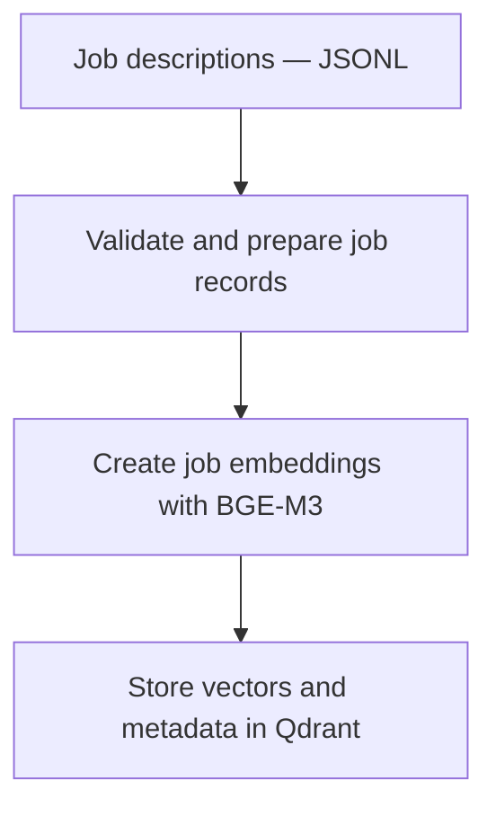
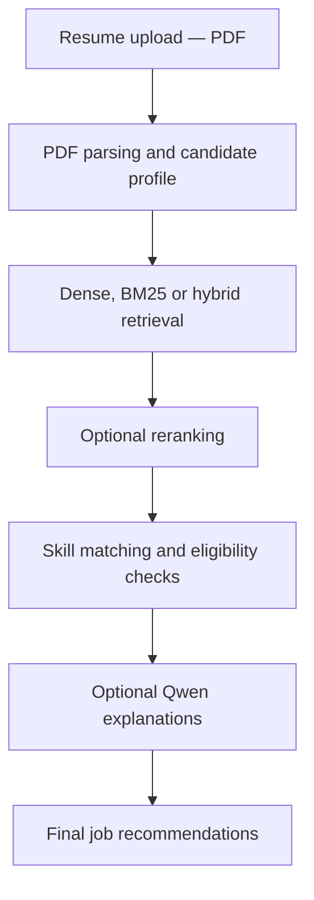
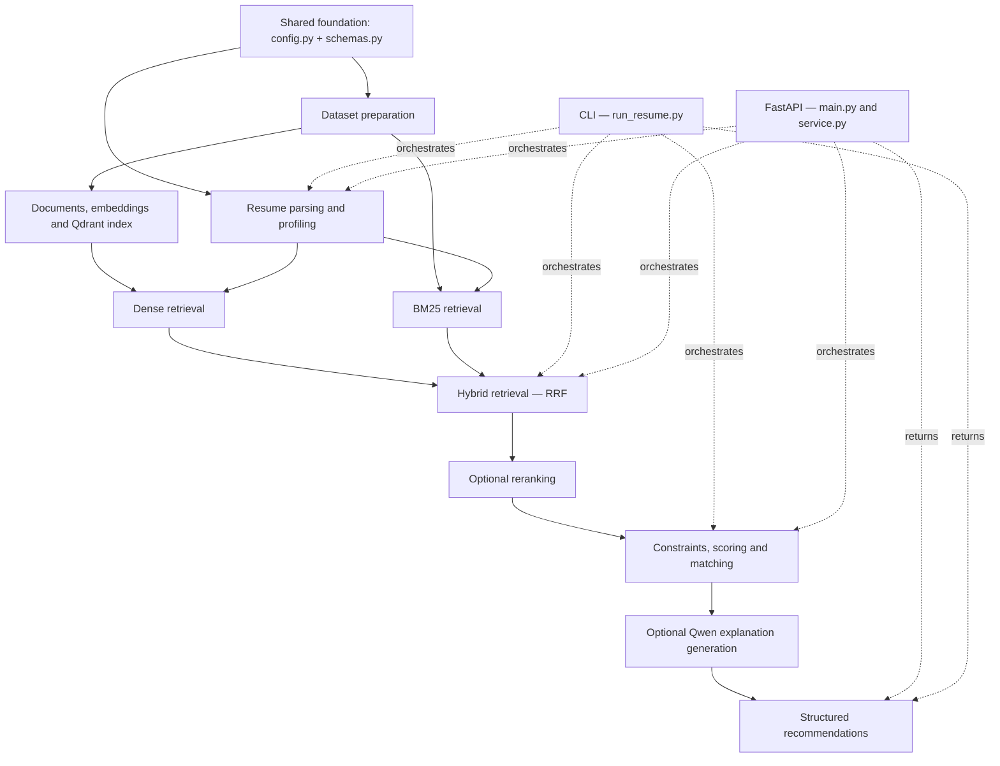

# JobFit — Complete Architecture & Codebase Learning Roadmap

**Repository:** [NehaarVeesam/Job-Fit](https://github.com/NehaarVeesam/Job-Fit)  
**Technology focus:** Python, LangChain, RAG, BGE-M3, Qdrant, BM25, FastAPI, Pydantic, Qwen  
**Goal:** Understand the complete JobFit application, from individual Python classes to the implementation of LangChain, RAG, hybrid retrieval, job matching, and FastAPI.

The recommended approach is to study **related files together as functional modules**, rather than reading every Python file independently.

> **Note:** This roadmap reflects the repository structure described in the prior analysis. File paths and implementation details may change as the repository evolves.

---

## 1. First, Understand the Two Major Workflows

JobFit has two conceptually separate workflows: preparing the searchable job corpus, and matching a user's resume against that corpus.

### Workflow A — Data Preparation (before matching)



### Workflow B — Resume Matching (user request)



**Important architectural points:**

- Job descriptions are prepared and indexed separately from individual resume requests.
- BM25-only execution can work without loading the embedding model or Qdrant index.
- Retrieval identifies relevant candidate jobs; downstream matching decides which jobs are suitable.
- The Qwen generation step is optional, not the source of eligibility decisions.

---

## 2. Recommended Learning Sequence

| Module | Subject | Main learning objective |
|---|---|---|
| 01 | Configuration and Pydantic schemas | Understand shared settings and data contracts |
| 02 | Job dataset preparation | Understand how the searchable corpus is built |
| 03 | Resume parsing and candidate profile | Understand how resumes become structured candidate data |
| 04 | LangChain, embeddings and Qdrant indexing | Understand vectorization and vector storage |
| 05 | Dense, BM25 and hybrid retrieval | Understand how candidate jobs are found |
| 06 | Cross-encoder reranking | Understand post-retrieval ranking improvements |
| 07 | Job eligibility, scoring and matching | Understand business rules and recommendation selection |
| 08 | LangChain and Qwen explanation generation | Understand grounded LLM explanations |
| 09 | Complete CLI and FastAPI orchestration | Understand how the application runs end to end |
| 10 | Evaluation, testing and metrics | Understand how quality is measured |
| 11 (optional) | Retrieval without LangChain | Compare framework-based and direct Python implementations |

---

## Module 01 — Configuration & Data Structures

**Study first.** These files establish the shared settings and types used throughout the application.

| Order | File path | Purpose |
|---|---|---|
| 1 | `app/config.py` | Centralized application settings |
| 2 | `app/schemas.py` | Pydantic models, validation and data contracts |
| 3 | `.env.example` | Environment variable configuration |
| 4 | `app/cli/check_setup.py` | Check configuration and example schemas |

**Concepts:** `BaseSettings`, `BaseModel`, `Field`, `field_validator`, `model_validator`, type hints, class methods, environment variables.

**Learning outcome:** Understand how objects such as `JobRecord`, `CandidateProfile`, `PreparedResume` and `MatchResponse` represent and transfer data between modules.

**Why it matters:** `app/schemas.py` is a shared contract for much of the application.

**Reference:** [app/schemas.py](https://github.com/NehaarVeesam/Job-Fit/blob/main/app/schemas.py)

---

## Module 02 — Job Dataset Preparation

**Focus:** Data ingestion, validation and preprocessing.

| Order | File path | Purpose |
|---|---|---|
| 1 | `dataset/jobs_synthetic_250.jsonl` | Original synthetic job descriptions |
| 2 | `app/dataset/dataset_loader.py` | Validate and prepare the complete job dataset |
| 3 | `app/corpus/dataset_loader.py` | Alternative corpus preparation implementation |
| 4 | `app/dataset_loader.py` | Entry-point wrapper for the corpus loader |

**Concepts:** JSONL reading, data validation, duplicate checking, Pydantic validation, skill evidence, output reporting.

**Learning outcome:** Trace how raw job descriptions become validated, structured job records ready for retrieval.

**Important:** The repository contains two dataset-preparation implementations. Study `app/dataset/dataset_loader.py` first because the full resume CLI uses it; then compare `app/corpus/dataset_loader.py`.

**Expected outputs:** `jobs.jsonl`, `skill_evidence.jsonl`, `validation_report.json`.

---

## Module 03 — Resume Parsing & Candidate Profiling

**Focus:** Converting a candidate's PDF resume into structured data.

| Order | File path | Purpose |
|---|---|---|
| 1 | `app/resumes/resume_parser.py` | Read PDF and extract page text |
| 2 | `app/resumes/profile.py` | Extract skills, experience, education and retrieval query |
| 3 | `app/cli/prepare_resume.py` | Execute resume preparation and save outputs |

**Concepts:** PyMuPDF, regex, text processing, evidence extraction, structured candidate profiles, query preparation.

**Learning outcome:** Trace the transformation:

```text
resume.pdf
  → parse_resume()
  → ParsedResume
  → build_profile()
  → PreparedResume
```

The resulting `PreparedResume` contains parsed resume information, candidate profile, user preferences and retrieval query.

**Important implementation detail:** Profile extraction is rule-based rather than LLM-based. It uses the job corpus's skill vocabulary and retains evidence from resume text.

---

## Module 04 — LangChain, Embeddings & Vector Database

**Focus:** Core RAG infrastructure and indexing.

| Order | File path | Purpose |
|---|---|---|
| 1 | `app/retrieval/documents.py` | Convert jobs into LangChain `Document` objects |
| 2 | `app/retrieval/embeddings.py` | Load BGE-M3 and create/validate embeddings |
| 3 | `app/retrieval/vector_index.py` | Create and verify the Qdrant vector index |
| 4 | `app/cli/download_models.py` | Download embedding and reranking models |
| 5 | `app/cli/dense_cli.py` | Run indexing and dense-search commands |
| 6 | `app/dense_cli.py` | Thin command-line entry-point wrapper |

**Concepts:** LangChain `Document`, `HuggingFaceEmbeddings`, `Embeddings`, tokenization, vector dimensionality, normalization, cosine similarity, `QdrantVectorStore`, indexing.

**Learning outcome:** Explain how job descriptions and resume queries become embeddings, and how Qdrant supports similarity search.

**Key distinction:** Job embeddings are prepared as part of indexing; a resume query is embedded at search time.

**Expected output:** A searchable Qdrant collection containing job vectors and metadata.

---

## Module 05 — Retrieval & Hybrid Search

**Focus:** Finding potentially relevant job descriptions.

| Order | File path | Purpose |
|---|---|---|
| 1 | `app/retrieval/filters.py` | Apply location and working-preference filters |
| 2 | `app/retrieval/keyword_search.py` | Implement BM25 keyword retrieval |
| 3 | `app/retrieval/dense.py` | Search semantically similar jobs in Qdrant |
| 4 | `app/retrieval/hybrid.py` | Combine dense and BM25 rankings via RRF |

**Concepts:** Lexical versus semantic search, BM25, Top-K, metadata filters, Reciprocal Rank Fusion, retrieval scores.

**Example:**

- **Dense retrieval** can find related LLM engineering jobs even without exact keyword overlap.
- **BM25** prioritizes meaningful literal terms such as `Python`, `LangChain` and `RAG`.
- **Hybrid retrieval** combines both rankings.

**Key function to trace:** `retrieve_candidates()` in `app/retrieval/hybrid.py`.

**Learning outcome:** Explain how the system returns a pool of relevant jobs before final suitability screening.

---

## Module 06 — Reranking

**Focus:** Optionally improve the ordering of retrieved jobs.

| Order | File path | Purpose |
|---|---|---|
| 1 | `app/retrieval/reranking.py` | Load a cross-encoder and rerank candidate jobs |

**Concepts:** Bi-encoder versus cross-encoder, inference scoring, batching, input/token limits.

**Learning outcome:** Explain why a relatively inexpensive retriever first creates a shortlist and a more detailed cross-encoder then reorders it.

**Important:** Reranking changes order, not the set of jobs retrieved, and does not establish eligibility or match probability.

---

## Module 07 — Job Eligibility & Matching

**Focus:** Business logic that determines which retrieved jobs actually fit the candidate.

| Order | File path | Purpose |
|---|---|---|
| 1 | `app/matching/constraints.py` | Check experience, education and hard requirements |
| 2 | `app/matching/scoring.py` | Compute skill coverage, eligibility and rejection reasons |
| 3 | `app/matching/matcher.py` | Apply policy and select final recommendations |

**Concepts:** Rule-based systems, skill coverage, hard and soft constraints, eligibility states, evidence validation, acceptance thresholds, rejection policies.

**Key functions to trace:** `assess_job()`, `rejection_reasons()`, `match_candidates()`.

**Learning outcome:** Explain why a job may appear highly relevant in semantic search yet still be excluded from final recommendations.

---

## Module 08 — LangChain & Qwen Generation

**Focus:** Optional, evidence-grounded explanation generation.

| Order | File path | Purpose |
|---|---|---|
| 1 | `app/matching/generation.py` | Build LangChain prompts and call Qwen |
| 2 | `app/matching/matcher.py` | Attach validated explanations to accepted matches |

**Concepts:** `ChatPromptTemplate`, `ChatOpenAI`, LangChain Expression Language (`|`), `PydanticOutputParser`, structured generation, hallucination controls, fallbacks.

**Learning outcome:** Explain how the LLM chooses from evidence-backed strengths and gaps and how the application validates generated content.

**Important:** Qwen does not independently decide job eligibility. The deterministic matching layer controls candidate acceptance.

---

## Module 09 — Application Orchestration: CLI & FastAPI

**Focus:** How all the modules are connected at runtime.

**Study CLI first, API second.**

| Order | File path | Purpose |
|---|---|---|
| 1 | `app/cli/run_resume.py` | Full matching pipeline from the command line |
| 2 | `app/cli/match_cli.py` | Match using a previously prepared resume |
| 3 | `app/api/service.py` | Orchestrate the matching flow for API requests |
| 4 | `app/api/schemas.py` | API request/response contracts |
| 5 | `app/api/main.py` | FastAPI endpoints, uploads and error handling |
| 6 | `app/main.py` | ASGI application entry point |

**Concepts:** Orchestration, imports, service objects, control flow, routes, async endpoints, thread pools, caching, HTTP request/response lifecycle.

**Most important starting point for end-to-end trace:** `app/cli/run_resume.py`.

**Then study:** `MatchingService.match()` in `app/api/service.py` to see the same underlying operations exposed via HTTP.

**Key API functionality:** `POST /match`, health/readiness checks and job-detail inspection via a stored run ID.

**Learning outcome:** Walk from a CLI command or HTTP request through parsing, retrieval, matching and response serialization.

---

## Module 10 — Evaluation & Metrics

**Focus:** Measure retrieval and recommendation quality.

| Order | File path | Purpose |
|---|---|---|
| 1 | `evaluation/suite.json` | Benchmark cases/configuration |
| 2 | `evaluation/judgments.jsonl` | Job suitability labels |
| 3 | `app/evaluation/fixtures.py` | Load and validate evaluation inputs |
| 4 | `app/evaluation/metrics.py` | Compute ranking and recommendation metrics |
| 5 | `app/evaluation/audits.py` | Audit evidence and policy behavior |
| 6 | `app/evaluation/reporting.py` | Generate evaluation summaries |
| 7 | `app/evaluation/runner.py` | Orchestrate benchmark execution |

**Concepts:** Precision@K, nDCG@K, no-match decisions, ground truth, evaluation splits, failure analysis and latency.

**Learning outcome:** Distinguish between ranking relevance and the accuracy of final job recommendations; understand how to validate system quality rather than relying on plausible-looking outputs.

---

## Module 11 — Optional: Python Without LangChain

**Focus:** Contrast direct library usage with the LangChain implementation.

| Order | File path | Purpose |
|---|---|---|
| 1 | `python_only/README.md` | Architectural comparison |
| 2 | `python_only/engine.py` | Direct embeddings and Qdrant retrieval |
| 3 | `python_only/cli.py` | CLI for direct indexing/search |
| 4 | `python_only/requirements.txt` | Dependencies |

**Concepts:** `SentenceTransformer`, `QdrantClient`, framework abstractions versus direct APIs.

**Learning outcome:** Explain what LangChain contributes and which operations can be implemented using lower-level Python libraries.

**When to study:** After Module 05 or after completing the main application.

---

## 3. How the Modules Connect



**Architecture clarification:** CLI and API are alternative entry points which call the underlying components. They are not additional sequential processing stages after matching.

---

## 4. Reusable Module Study Checklist

Apply the following checklist to *each* module before moving on:

- [ ] Understand the module's purpose, inputs and outputs.
- [ ] Read its classes and functions in execution order.
- [ ] Trace imports and calls between its scripts.
- [ ] Walk one realistic example through the data transformations.
- [ ] Identify edge cases and important design decisions.
- [ ] Summarize the module's dependency on previous modules and its output to the next module.

For example, Module 03 should end with a clear understanding of:

```text
resume.pdf → parse_resume() → ParsedResume → build_profile() → PreparedResume
```

This is more efficient than jumping between unrelated files and repeatedly reconstructing the architecture.

---

## 5. Outcomes After Completing the Roadmap

You should be able to explain:

1. How JobFit processes a PDF resume and constructs a candidate profile.
2. How BGE-M3 generates embeddings and how Qdrant stores and retrieves them.
3. Why BM25 and dense retrieval complement one another.
4. How RRF combines rankings and why reranking is a separate stage.
5. Why relevant retrieved jobs are not necessarily eligible matches.
6. How deterministic scoring and constraints determine final recommendations.
7. Why Qwen is an optional grounded-explanation layer rather than the sole decision-maker.
8. How the CLI and FastAPI endpoints orchestrate shared business logic.
9. How evaluation metrics reveal different quality and failure modes.
10. What LangChain abstracts compared with a plain-Python implementation.

### Recommended first study session

Start with **Module 01**:

1. `app/config.py`
2. `app/schemas.py`
3. `.env.example`
4. `app/cli/check_setup.py`

Explain the actual classes, functions, imports, data structures and important lines. Then use a single small example across subsequent modules to connect the implementation end to end.

---

*Repository: https://github.com/NehaarVeesam/Job-Fit*
