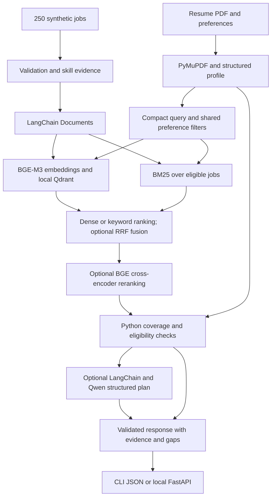

# JobFit — Evidence-Based Resume-to-Job Matching

A beginner-friendly RAG project that matches a searchable resume PDF against
**250 fictional India-based AI and software jobs**, explains missing skills, and
returns supporting quotes from the resume and job description.

Built with **Python, LangChain, BGE-M3, BM25, Qdrant, BGE reranking, Qwen, and
FastAPI**. A [Python-only retrieval implementation](python_only/README.md) shows
the same embedding/search steps without LangChain.

> **Portfolio scope complete: Modules 0–9.** This is an offline educational
> project with a local API, repeatable CLI demo, and scoped synthetic evaluation.
> All jobs and example resumes are fictional. No live vacancies are collected.

## See the project without installing models

- [Actual AI match response](examples/results/ai_match_response.json)
- [Actual no-match response](examples/results/unrelated_no_match_response.json)
- [Evaluation results](evaluation/results.md) and [failure analysis](evaluation/failure_report.md)
- [Full portfolio walkthrough](docs/module_9_portfolio.md)

The two demo responses are actual pipeline outputs over all 250 source jobs.
The evaluation metrics use a separate, explicitly identified 17-job panel.

## What it does

- Validates the supplied dataset and preserves source IDs and synthetic markers.
- Extracts PDF text locally and builds a rule-based candidate profile with evidence.
- Retrieves by semantic similarity, technical keywords, or their fused ranking.
- Optionally reranks retrieved jobs with a local cross-encoder.
- Checks required/preferred skill coverage, experience, education, preferences,
  and explicit job conditions, keeping unresolved outcomes visible.
- Optionally asks Qwen for structured selections of supported strengths/gaps;
  Python validates those selections and renders cited explanations.
- Exposes matching and selected-job inspection through a CLI and FastAPI.

## Architecture



| Component | Role |
|---|---|
| PyMuPDF + Pydantic | PDF text extraction and validated data contracts |
| `BAAI/bge-m3` | 1024-dimensional L2-normalized dense embeddings |
| Qdrant + LangChain integration | Persistent local vectors and filtered retrieval |
| BM25 + reciprocal rank fusion | Exact technical terms and hybrid ranking |
| `BAAI/bge-reranker-v2-m3` | Optional query/job pair scoring and reordering |
| LangChain prompts + remote Qwen | Optional constrained evidence-selection plans |
| FastAPI | Upload, matching, run deletion, and selected-job endpoints |

Modules 1–2 make no LLM calls. Embeddings and reranking run locally. Qdrant uses
persistent local mode by default; Docker is not required. The Qwen endpoint and
credentials stay in local configuration.

## Setup and one-command demo

Verified on **Linux, Python 3.11, CPU**. Other platforms/Python versions have not
been verified with the pinned lock file. BGE-M3 includes roughly 2.3 GB of weights;
optional BGE reranking adds roughly 2.27 GB, plus dependencies and caches.

```bash
git clone https://github.com/NehaarVeesam/Job-Fit.git
cd Job-Fit
python3.11 -m venv .venv
source .venv/bin/activate
python -m pip install -r requirements.lock
python -m pip install --no-deps --no-build-isolation -e .
cp .env.example .env
python -m app.check_setup
python scripts/download_embeddings.py
python scripts/run_demo.py
```

Copy `.env.example` only on initial setup; preserve an existing `.env`. Its
placeholder Qwen endpoint is sufficient for setup validation. The default demo
uses hybrid retrieval, no reranking, no Qwen calls, and blocks network socket
connections after the model download.

The demo prepares all 250 jobs, generates PDFs from the public text resumes,
extracts profiles, builds/reuses the index, and saves both match and no-match
results under ignored `artifacts/portfolio_demo/`.

| AI demo job | Required skill coverage | Missing required evidence |
|---|---|---|
| Generative AI Engineer (`syn_job_001`) | 4/6 = 66.7% | Vector databases, Prompt engineering |
| RAG Engineer (`syn_job_105`) | 3/6 = 50% | Vector databases, Hybrid search, LLM evaluation |

The unrelated pastry-chef resume produces `no_suitable_matches` with an empty
recommendation list. A 66.7% coverage value is **not** a hiring probability or
proof of proficiency. Retrieval scores, coverage, and eligibility are separate.

### Use your own resume PDF and retain run logs

```bash
python scripts/check_artifacts.py
python scripts/run_resume.py "/absolute/path/to/your_resume.pdf"
```

The PDF command extracts page text and a structured profile, embeds its compact
query with BGE-M3, builds/reuses job vectors, and runs hybrid matching locally.
Each run saves the actual query embedding, stage logs, retrieval/assessment
reports, final response and checksums in `artifacts/resume_runs/<timestamp>_<id>/`.
Real resumes and generated personal data remain ignored by Git. Historical runs
have reports but may lack persistent console logs. See the
[real PDF guide](docs/run_real_resume.md) for optional reranking/Qwen, output files,
limits and regeneration commands.

### Optional reranking and Qwen

```bash
python scripts/download_reranker.py
python scripts/run_demo.py --profile ai --rerank
```

Reranking is off by default. It preserves original retrieval scores and acceptance
checks, exposes a separate raw-logit score, and checks complete-pair token lengths.
The default budget is 512 tokens, configurable up to 8,192. Input overflow or
model failure gives a labeled fallback to the original order. The Module 7 CPU
run added about 22.7–24.7 seconds per 30-job pool; short filtered lists take less.

For Qwen plans, set your remote OpenAI-compatible endpoint locally:

```dotenv
QWEN_BASE_URL=https://YOUR_QWEN_HOST/v1
QWEN_API_KEY=YOUR_API_KEY
QWEN_MODEL=Qwen/Qwen3.8-27B
QWEN_JSON_MODE=json_schema
```

Use the model ID served by your endpoint, then run:

```bash
python scripts/run_demo.py --profile ai --with-llm
```

The generation prompt contains compact skill assessments, not raw resume pages
or company prose. Invalid/unavailable generation has a labeled deterministic
fallback. No model-authored suitability score or unrestricted prose enters the
response. See [Module 4](docs/module_4_matching.md).

## Local API

Prepare the standard API corpus and index, then start one process:

```bash
python -m app.dataset_loader
python -m app.dense_cli index
python -m uvicorn app.main:app --host 127.0.0.1 --port 8000 --workers 1 --no-access-log
```

Open [interactive API docs](http://127.0.0.1:8000/docs), or use another terminal:

```bash
curl -X POST http://127.0.0.1:8000/match \
  -F 'resume=@artifacts/demo_resumes/ai.pdf;type=application/pdf' \
  -F 'preferences=<examples/preferences.json' \
  -F 'use_llm=false'
```

| Endpoint | Purpose |
|---|---|
| `GET /health` | Process health and busy status |
| `GET /ready` | Prepared corpus readiness; model/index checked on use |
| `POST /match` | Upload PDF, receive results and a short-lived `run_id` |
| `GET /runs/{run_id}/jobs/{job_id}` | Inspect a job, including rejected jobs |
| `DELETE /runs/{run_id}` | Delete a cached run |

The API defaults to dense retrieval; use `JOBFIT_RETRIEVAL_MODE=hybrid` and,
optionally, `JOBFIT_RERANK_ENABLED=true`, then restart to change those settings.
It has no authentication, processes one matching/detail request at a time,
accepts up to 5 MiB/10 PDF pages by default, and retains at most 20 process-local
runs for 30 minutes. Temporary PDFs are cleaned up. CLI outputs persist locally.
See [Module 5](docs/module_5_api.md) for limits, timeout behavior, and errors.

## Evaluation and measured limitations

The [frozen suite](evaluation/README.md) contains 12 new synthetic resumes,
204 explicit suitability judgments, and a controlled 17-job panel selected from
the original 250 jobs. Four cases are development and eight are held out from
tuning within the suite. **Labels are assistant-authored, not independent human
expert reviews.**

| Held-out panel method | Mean nDCG@5 | Strict accepted precision |
|---|---:|---:|
| Dense | 0.965 | 0.500 |
| BM25 | 0.974 | 0.500 |
| Hybrid | 0.965 | 0.500 |
| Hybrid + BGE reranker | 0.974 | 0.500 |

Each method returns five fully suitable and five partial/conditional jobs across
the eight held-out cases; no accepted panel job is graded completely unsuitable.
P@5 is 0.125, matching the panel's attainable ceiling because many cases have
only one suitable job after preferences. Both constructed no-match cases are
handled correctly. All 829 scoped evidence/policy checks pass; a separate bounded
live Qwen probe made one call and passed 14 rendered-support checks.

Partial fits expose framework gaps, target-seniority mismatch, and unresolved
metadata. Small ranking differences do not establish general model superiority.
Full 250-job diagnostics report missing-judgment coverage and precision bounds;
unlabeled jobs are not assumed irrelevant, and empty returns never receive
perfect accepted precision. Read the [results](evaluation/results.md),
[failure report](evaluation/failure_report.md), and
[full-corpus diagnostic](evaluation/full_corpus/results.md).

To reproduce after downloading the models:

```bash
python -m app.dataset_loader
python -m app.evaluation.runner
# Optional one-pair live Qwen structured-plan probe:
python -m app.evaluation.runner --qwen-probe
# Full corpus, explicitly accounting for incomplete labels:
python -m app.evaluation.runner --scope full --split heldout --variants dense bm25 hybrid
```

Timing summaries use one warm text-pipeline observation per case, excluding
model loading, indexing, PDF parsing, HTTP, and Qwen latency. They are development
observations, not load-test guarantees. The dataset is short, uniform and
fictional; these scores do not estimate full-corpus or real-world hiring accuracy.

## Verification

```bash
python -m app.check_setup
python -m unittest discover -s tests -v
python -m unittest discover -s python_only -v
python -m pip check
```

**140 main tests and five Python-only tests pass**. The original 136 main
tests and five Python-only tests also passed in a clean source copy with template
configuration, no runtime artifacts, and the existing pinned dependency environment.
The four additional checks cover PDF-run logging, exact query-vector capture,
checksums, and failure artifacts. Fast checks use test doubles
without model downloads or live Qwen calls. Separate cached-model checks cover
BGE-M3, Qdrant, BGE reranking, the match/no-match demo, and scoped evaluation.
See the module guides for reproduction commands and evidence boundaries.

## Repository and learning guides

```text
app/                 Preparation, retrieval, matching, API, evaluation code
python_only/         Direct Sentence Transformers/Qdrant retrieval comparison
dataset/             Original synthetic JSONL, CSV, dataset card
examples/            Public synthetic inputs, contract examples, actual demo responses
evaluation/          Frozen fixtures, judgments, sanitized results and failures
scripts/             Model downloads, repeatable demo, verification commands
tests/               Automated checks
docs/                Module explanations and portfolio walkthrough
plan.md              Completed scope, architecture decisions, future extensions
requirements.lock    Pinned verified CPU environment
artifacts/           Generated PDFs, profiles, indexes, weights, raw outputs (ignored)
```

| Module | Responsibility | Guide |
|---|---|---|
| 0 | Configuration and contracts | [Complete](docs/module_0_setup.md) |
| 1 | Dataset preparation | [Complete](docs/module_1_dataset.md) |
| 2 | PDF extraction and profile | [Complete](docs/module_2_resume.md) |
| 3 | LangChain, BGE-M3, Qdrant | [Complete](docs/module_3_langchain.md) |
| 4 | Coverage, constraints, Qwen plans | [Complete](docs/module_4_matching.md) |
| 5 | FastAPI | [Complete](docs/module_5_api.md) |
| 6 | BM25 and hybrid retrieval | [Complete](docs/module_6_hybrid.md) |
| 7 | Optional BGE reranking | [Complete](docs/module_7_reranking.md) |
| 8 | Scoped evaluation and failures | [Complete](docs/module_8_evaluation.md) |
| 9 | Reproducible portfolio walkthrough | [Complete](docs/module_9_portfolio.md) |

The JSON files directly inside `examples/` are hand-authored contract examples.
[examples/results/](examples/results/README.md) contains actual synthetic demo
outputs with checksums. [python_only/](python_only/README.md) explains which
integration steps LangChain replaces; it does not claim automatic accuracy gains.

## Published data and future work

GitHub includes the original **synthetic** job dataset, synthetic text resumes,
actual typed demo responses, frozen judgments/configuration, and sanitized
aggregate results/failures. Credentials, real resumes, PDFs, environments,
model weights, vectors, and raw artifacts remain excluded. See the
[publishing policy](docs/publishing.md).

The planned offline portfolio scope is complete. Extensions include broader
human-reviewed full-corpus evaluation, stronger critical-framework/seniority
handling, OCR/layout support, and optional UI/deployment. Current skill mentions
are not proficiency proof, thresholds are heuristic, and the local API is not a
multi-user production service.

No project license has been selected; model and dependency terms apply separately.
