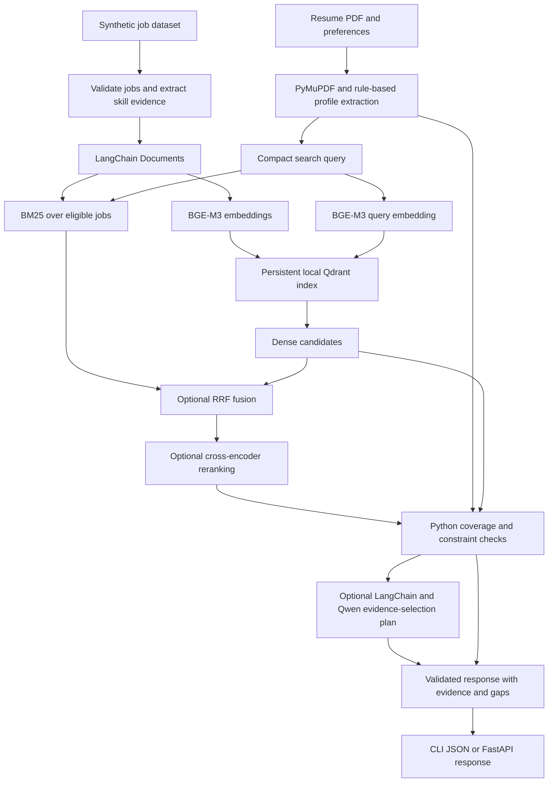

# JobFit — Resume-to-Job Matcher

A beginner-friendly RAG project that matches a resume against **250 synthetic
India-based AI and software jobs**, explains skill gaps, and returns evidence
from both the resume and job description.

Built with **Python, LangChain, BGE-M3, Qdrant, Qwen, and FastAPI**. A separate
[Python-only retrieval implementation](python_only/README.md) shows the same
embedding and search steps without LangChain.

> All jobs and example resumes are fictional. This project does not fetch live
> vacancies. Modules 0–7 are implemented; formal
> evaluation and an optional UI remain on the roadmap.

## What it does

- Validates the supplied dataset and preserves its original files.
- Extracts text from searchable PDFs and builds a structured candidate profile.
- Searches jobs using normalized, 1024-dimensional `BAAI/bge-m3` dense vectors.
- Applies location/work-mode preferences and checks experience, education, and
  explicit job conditions, preserving unknown outcomes.
- Reports required/preferred skill coverage separately, with supporting quotes.
- Uses LangChain and a remote OpenAI-compatible Qwen endpoint to select supported
  strengths and gaps. Python validates the selections and renders the response.
- Offers both a CLI and HTTP endpoints, including a valid no-match response.

## Architecture



Modules 1–2 make no LLM calls. Module 3 uses the embedding model locally.
Module 4 optionally calls Qwen; Module 5 exposes the existing pipeline over HTTP.
Qdrant runs locally by default, so Docker is not required.

## Quick start

The pinned environment was verified on **Linux, Python 3.11, CPU**. The project
requires Python 3.11 or newer, but other platforms/Python versions have not been
verified with this lock file. The BGE-M3 download includes roughly 2.3 GB of
weights; allow additional disk space for dependencies and caches.

Run these commands from the repository root:

```bash
python3.11 -m venv .venv
source .venv/bin/activate
python -m pip install -r requirements.lock
python -m pip install --no-deps --no-build-isolation -e .
cp .env.example .env
python -m app.check_setup
```

Copy `.env.example` only on initial setup; preserve an existing `.env`.
The initial checks and deterministic matching need no live Qwen service.
The template contains a placeholder endpoint for configuration validation.

### 1. Prepare the jobs and demo resumes

```bash
python -m app.dataset_loader
python scripts/create_demo_resumes.py
python -m app.prepare_resume artifacts/demo_resumes/ai.pdf --preferences examples/preferences.json
```

The dataset command creates `artifacts/dataset/all/` with validated jobs, skill
evidence, and a validation report. Resume preparation prints an output directory
containing `prepared_resume.json`; use that path in the matching commands below.
Demo PDFs are generated from the public synthetic text files in `examples/resumes/`.

### 2. Download the embedding model and build the index

```bash
python scripts/download_embeddings.py
python -m app.dense_cli index
```

The downloader uses a pinned BGE-M3 revision. Model files, vector storage, and
index manifests stay under ignored `artifacts/`. Repeating the index command
reuses a complete, verified index. Use one process at a time with local Qdrant;
finish CLI operations before starting the API.

### 3. Match a prepared resume

Replace `PATH_TO_PREPARED_RESUME.json` with the path printed in step 1:

```bash
python -m app.match_cli --prepared-resume PATH_TO_PREPARED_RESUME.json --no-llm
```

Results and assessment reports are saved under `artifacts/matches/`.
For optional Qwen generation, edit these entries in your local `.env`:

```dotenv
QWEN_BASE_URL=https://YOUR_QWEN_HOST/v1
QWEN_API_KEY=YOUR_API_KEY
QWEN_MODEL=Qwen/Qwen3.8-27B
QWEN_JSON_MODE=json_schema
```

Use the model identifier served by your endpoint. Then run the same matching
command without `--no-llm`. Invalid or unavailable generation produces a labeled
deterministic fallback. Qwen receives compact skill assessments for this step;
raw resume pages are not included in the generation prompt.

### 4. Use the API

After preparing the dataset and index:

```bash
python -m uvicorn app.main:app --host 127.0.0.1 --port 8000 --workers 1 --no-access-log
```

Open [interactive API documentation](http://127.0.0.1:8000/docs), or run this in
another terminal:

```bash
curl -X POST http://127.0.0.1:8000/match \
  -F 'resume=@artifacts/demo_resumes/ai.pdf;type=application/pdf' \
  -F 'preferences=<examples/preferences.json' \
  -F 'use_llm=false'
```

| Endpoint | Purpose |
|---|---|
| `GET /health` | Process health and busy status |
| `GET /ready` | Prepared corpus readiness; models/index checked on use |
| `POST /match` | Upload a PDF and receive recommendations plus a `run_id` |
| `GET /runs/{run_id}/jobs/{job_id}` | Inspect a particular job, including rejected jobs |
| `DELETE /runs/{run_id}` | Delete the cached run |

The local API has no authentication. It processes one matching/detail request at
a time, accepts PDFs up to 5 MiB/10 pages by default, and retains at most 20 runs
in process memory for 30 minutes. Temporary uploads are deleted after processing;
CLI outputs persist locally until you remove them. See the
[API guide](docs/module_5_api.md) for timeout behavior and errors.

## Compare keyword and hybrid search

Module 6 adds BM25 keyword retrieval and RRF fusion with dense search. Defaults
use the top 30 candidates per branch and retain 30 fused candidates:

```bash
python -m app.search_cli --prepared-resume PATH_TO_PREPARED_RESUME.json --mode compare --k 30
python -m app.match_cli --prepared-resume PATH_TO_PREPARED_RESUME.json --retrieval-mode hybrid --no-llm
```

For the API, set `JOBFIT_RETRIEVAL_MODE=hybrid` in `.env` and restart it. Dense
remains the default. Hybrid keeps the existing cosine acceptance check separate
from its RRF ranking score. BM25-only matching uses positive keyword overlap
instead of that cosine gate, so recommendation counts are not quality metrics.
See [Module 6](docs/module_6_hybrid.md) for formulas, token handling, settings,
rank traces, and the five-profile real-model comparison. Reproduce it with:

```bash
python scripts/verify_hybrid.py
```

## Optional cross-encoder reranking

Module 7 scores each query/job pair together using the local
`BAAI/bge-reranker-v2-m3` model. It reorders the retrieved candidate
pool while retaining original scores and all coverage/eligibility checks:

```bash
python scripts/download_reranker.py
python -m app.match_cli --prepared-resume PATH_TO_PREPARED_RESUME.json --retrieval-mode hybrid --rerank --no-llm
```

The API uses it when `JOBFIT_RERANK_ENABLED=true`; restart after changing settings.
It is **off by default**. The default pair budget is 512 tokens (configurable up
to 8,192); overflow/model
failure gives a labeled fallback to the original order. Cross-encoder scores are
separate raw logits, not probabilities. The local five-profile development run
added about 22.7–24.7 seconds per 30-job pool on CPU (batch size 2). Both dense and cross-encoder scoring
agreed with all four easy topical pair labels, showing no gain on that small set.

See [Module 7](docs/module_7_reranking.md) for score contracts, budgets, commands,
limitations, and the reproducible [benchmark configuration](examples/reranker/benchmark.json).
Run the real-model comparison with `python scripts/verify_reranker.py`.

## Understanding the results

The AI demo selected two jobs during development verification:

| Job | Required skill coverage | Example missing required skills |
|---|---|---|
| `syn_job_001` — Generative AI Engineer | 4/6 = 66.7% | Vector databases, Prompt engineering |
| `syn_job_105` — RAG Engineer | 3/6 = 50% | Vector databases, Hybrid search, LLM evaluation |

Coverage counts evidenced skill mentions; **66.7% coverage is not a 66.7% chance
of getting hired**. Cosine similarity is a separate retrieval signal. Experience,
education, and other conditions are assessed separately. Unknown conditions can
remain conditional under the default preference policy.

These are development examples, not held-out quality measurements. Reproduce
outputs locally; generated verification artifacts are excluded from Git.
The JSON files directly inside `examples/` are hand-authored contract examples,
rather than current pipeline results.

## Repository structure

```text
app/                 Settings, schemas, preparation, retrieval, matching, API
python_only/         Direct Sentence Transformers/Qdrant retrieval comparison
dataset/            Original synthetic JSONL, CSV, and dataset card
examples/            Synthetic text resumes and JSON contract examples
scripts/             Demo PDF creation, model download, live verification
tests/              Module 0–7 automated checks
docs/               Detailed module explanations and development results
plan.md              Scope, architecture decisions, checkpoints, roadmap
pyproject.toml       Package metadata and direct dependencies
requirements.lock    Pinned verified CPU environment
.env.example         Configuration template without credentials
artifacts/           Generated data, PDFs, weights, indexes, results (ignored)
```

## Modules and learning guides

| Module | Responsibility | Status / guide |
|---|---|---|
| 0 | Configuration and data contracts | [Complete](docs/module_0_setup.md) |
| 1 | Dataset validation and evidence preparation | [Complete](docs/module_1_dataset.md) |
| 2 | PDF extraction and structured candidate profile | [Complete](docs/module_2_resume.md) |
| 3 | LangChain Documents, BGE-M3 embeddings, Qdrant search | [Complete](docs/module_3_langchain.md) |
| 4 | Skill coverage, conditions, grounded Qwen plans | [Complete](docs/module_4_matching.md) |
| 5 | FastAPI upload, matching, and job detail | [Complete](docs/module_5_api.md) |
| 6 | BM25 and hybrid retrieval comparisons | [Complete](docs/module_6_hybrid.md) |
| 7 | Optional cross-encoder reranking | [Complete](docs/module_7_reranking.md) |
| 8 | Judged examples, retrieval/constraint evaluation, latency | Pending |
| 9 | Optional UI and final reproducible demo | Pending |

To compare LangChain with direct Python, start with the
[Python-only guide](python_only/README.md). Both implementations were checked
against the same model, inputs, and filters; LangChain changes the integration
code, rather than automatically improving retrieval accuracy.

## Verification

Fast checks use controlled vectors and test doubles, without downloading models
or contacting a live Qwen service:

```bash
python -m app.check_setup
python -m unittest discover -s tests -v
python -m unittest discover -s python_only -v
python -m pip check
```

At the Module 7 checkpoint, **118 main tests and 5 Python-only tests passed**.
Separate development checks exercised real BGE-M3/Qdrant retrieval and actual
remote Qwen generation over HTTP. These checks do not establish general matching
accuracy. See [retrieval results](docs/module_3_results.md) and the module guides.

Optional real-model checks, after completing setup:

```bash
python scripts/verify_dense.py
# In another terminal, with the API running:
python scripts/verify_api.py --url http://127.0.0.1:8000
# Add --use-llm to verify the configured remote Qwen service too.
```

## Scope and limitations

- The [dataset](dataset/DATASET_CARD.md) contains 250 fictional jobs, split evenly
  between AI/ML and software. It is not a current India jobs feed.
- Resume preparation is rule-based. It can miss aliases and complex layouts;
  scanned PDFs need OCR, which is not implemented.
- Skill mentions and matching quotes do not prove proficiency or suitability.
- Coverage and cosine thresholds are development heuristics. Formal suitability
  evaluation is pending; optional reranking is implemented but disabled by default.
- The API is a local demonstration with process-local sessions, not a deployed
  multi-user service.

## Publishing this repository

Commit source, tests, guides, synthetic examples/dataset, dependency files, and
`.env.example`. Keep `.env`, real resumes, local agent/cloud settings, the virtual
environment, model weights, and all generated artifacts out of Git.

See [the publishing checklist](docs/publishing.md) for the exact file list and
initial Git/GitHub commands. No project license has been selected yet; choose one
before describing this repository as licensed for reuse.
